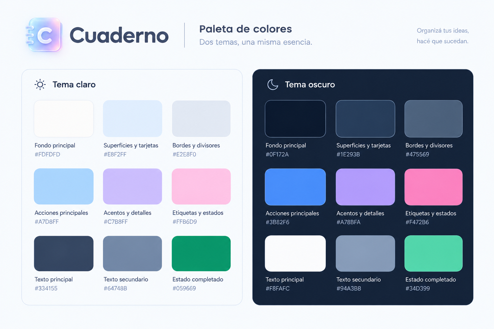

# 📓 Bitácora de Uso y Asistencia de Inteligencia Artificial

> **Proyecto:** Cuaderno (Gestor de tareas minimalista con estética _Glassmorphism_)  
> **Desarrollador:** Rey Gabriel  
> **Objetivo del documento:** Registrar de manera transparente, metódica y estructurada todas las interacciones con herramientas de Inteligencia Artificial a lo largo del ciclo de vida del desarrollo, incluyendo prompts, análisis crítico de las respuestas, decisiones adoptadas y evidencias visuales (capturas de pantalla).

---

## 🗂️ Índice de Etapas de Desarrollo

- [Etapa 0: Ideación y Naming](#-etapa-0-ideación-y-naming)
- [Etapa 1: Diseño de identidad visual y paletas UX/UI](#-etapa-1-diseño-de-identidad-visual-y-paletas-uxui)
- [Etapa 2: Autenticación Robusta con Firebase Auth](#-etapa-2-autenticación-robusta-con-firebase-auth)
- [Etapa 3: Persistencia Reactiva en Tiempo Real con Cloud Firestore](#-etapa-3-persistencia-reactiva-en-tiempo-real-con-cloud-firestore)
- [Etapa 4: Componentes Accesibles con Glassmorphism y Métricas Dinámicas](#-etapa-4-componentes-accesibles-con-glassmorphism-y-métricas-dinámicas)
- [Etapa 5: Arquitectura Serverless y Despacho de Correo con AWS SES](#-etapa-5-arquitectura-serverless-y-despacho-de-correo-con-aws-ses)
- [Etapa 6: Testing Automatizado con Vitest y React Testing Library](#-etapa-6-testing-automatizado-con-vitest-y-react-testing-library)
- [Etapa 7: Seguridad, Despliegue en Vercel y Resolución de Conflictos Cloud](#-etapa-7-seguridad-despliegue-en-vercel-y-resolución-de-conflictos-cloud)
- [Etapa 8: Auditoría UX/UI, Refactorización de Estilos y Sistema de Cambio de Tema (Light/Dark)](#-etapa-8-auditoría-uxui-refactorización-de-estilos-y-sistema-de-cambio-de-tema-lightdark)
- [📋 Plantilla Reutilizable para Nuevas Interacciones](#-plantilla-reutilizable-para-nuevas-consultas)
- [Guía para adjuntar capturas de pantalla](#-guía-para-adjuntar-capturas-de-pantalla)

---

## 🚀 Etapa 0: Ideación y Naming

### 📋 Ficha Técnica

- **Fecha:** 11/10/2026
- **Modelo:** Google Gemini
- **Objetivo:** Lluvia de ideas y validación de naming/branding para el proyecto integrador (gestor de tareas).

---

### 📥 1. Prompt Inicial (Usuario)

> _"Tengo que hacer un gestor de tareas como proyecto integrador de mi curso de programación. Que nombre recomendarias? Pensé en DO-Tasks... recomendame algunos."_

---

### 📤 2. Respuesta de la IA

- **Análisis de la propuesta:** Validación de _DO-Tasks_.
- **Propuestas presentadas (categorizadas en tres enfoques):**
  - **Guiños a código:** `TaskScript`, `CommitTask`, `Console.todo()`, `BitTask`.
  - **Minimalistas / Startups:** `Taskify`, `ZenTask`, `Tickly`, `NexusTask`.
  - **En español:** `HacerApp`, `PendienteX`, `Metódico`.

---

### 🔄 3. Intercambio y Refinamiento (Iteración)

#### Prompt del Usuario (Iteración 1)

> _"Pienso en darle un estilo minimalista actual como liquid glass de Apple... Me gusta el nombre Cuaderno... que te parece?"_

#### Respuesta de la IA (Iteración 1)

- **Evaluación del concepto:** Se aprobó y valoró positivamente el nombre **Cuaderno**, destacando el contraste armónico entre un concepto tradicional/analógico y una estética digital vanguardista (_Liquid Glass / Glassmorphism_).
- **Sugerencia de variantes:** `Cuaderno Glass`, `Cuaderno.glass`, `Cuaderno OS`.
- **Aportes técnicos y de diseño:** Recomendaciones rápidas de UI (tipografías sans-serif limpias, paletas de colores neutras y reglas CSS para el efecto translúcido/vidrio desenfocado `backdrop-filter`).

---

### 📸 4. Evidencias Visuales (Capturas de Pantalla)

<!-- Pega aquí la captura de tu conversación con Gemini -->

  
_Captura 0.1: Intercambio con Google Gemini definiendo el nombre "Cuaderno" y el estilo visual Liquid Glass._

---

### 📌 5. Conclusiones y Decisiones Tomadas

- [x] **Nombre seleccionado:** **Cuaderno** (con posibilidad de usar _Cuaderno.glass_ como identidad de marca/subtítulo).
- [x] **Dirección del proyecto:** Gestor de tareas con interfaz minimalista inspirada en el efecto _Liquid Glass_ (estilo Apple / Glassmorphism moderno).
- [x] **Criterio de adopción:** Se descartaron nombres técnicos en inglés en favor de un nombre cercano y directo en español que enfatice simplicidad y claridad de uso.

---

## 🚀 Etapa 1: Diseño de identidad visual y paletas UX/UI

### 📋 Ficha Técnica

- **Fecha:** 11/10/2026
- **Modelo:** ChatGPT (GPT-6)
- **Objetivo:** Diseñar una propuesta de logo minimalista para una aplicación web mobile-first de gestión de tareas llamada Cuaderno, utilizando Glassmorphism, y definir dos paletas de colores coherentes para los temas claro y oscuro.

---

### 📥 1. Prompt Inicial (Usuario)

> _"Se un diseñador gráfico experto diseño UI/UX._  
> _Estoy por hacer una aplicación web mobile-first de un gestor de tareas. El nombre va a ser Cuaderno, así con la C mayúscula. El concepto de diseño de la app es Glassmorphism. Necesito un logo. No debería ser tan invasivo porque la idea es mantenerlo limpio como un cuaderno nuevo. Dame una propuesta."_

---

### 📤 2. Respuesta de la IA

- **Puntos clave de la respuesta:**
  - **Identidad visual:** Se propuso un isotipo con forma de cuaderno de hojas translúcidas, bordes redondeados y una letra «C» blanca como elemento central.
  - **Estilo gráfico:** Se aplicó el concepto Glassmorphism mediante transparencias, efecto de vidrio esmerilado, reflejos suaves, degradados pastel y sombras difuminadas.
  - **Tipografía:** Se recomendó una tipografía sans serif moderna, limpia y ligeramente redondeada, utilizando el nombre «Cuaderno» con la C mayúscula.
  - **Tema oscuro:** Se desarrolló una propuesta visual con fondo azul noche, superficies azuladas y reflejos en azul, lavanda y rosa.
  - **Tema claro:** Se generó una propuesta complementaria con fondos blancos y grisáceos, azul cielo, lavanda y rosa pastel.
  - **Diseño adaptable:** Se mostraron variantes del icono para diferentes tamaños y simulaciones de interfaz de escritorio y móvil.
  - **Criterios UX/UI:** Se recomendó priorizar la legibilidad, mantener espacios en blanco y reservar los efectos de vidrio para tarjetas, paneles y elementos de navegación.
  - **Implementación técnica:** Se sugirieron valores iniciales para opacidad, desenfoque, bordes redondeados y sombras.

#### 🎨 Paletas de colores propuestas

**Tema claro**

| Uso                          | Tema Claro | Tema Oscuro |
| ---------------------------- | ---------- | ----------- |
| Fondo principal              | #FDFDFD    | #0F172A     |
| Superficies y tarjetas Glass | #E8F2FF    | #1E293B     |
| Bordes y divisores           | #E2E8F0    | #475569     |
| Acciones principales         | #A7D8FF    | #3B82F6     |
| Acentos y detalles           | #C7B8FF    | #A78BFA     |
| Etiquetas y estados          | #FFB6D9    | #F472B6     |
| Títulos y contenido          | #334155    | #F8FAFC     |
| Texto secundario             | #64748B    | #94A3B8     |
| Estado completado            | #059669    | #34D399     |



---

### 🔄 3. Intercambio y Refinamiento (Iteración)

#### Prompts del Usuario (Iteraciones de seguimiento)

- **Iteración 1 (Tema oscuro):**

  > _"Me encantó el diseño y las recomendaciones. Me puedes dar una opción para el tema oscuro de la app con su respectiva paleta de colores."_

- **Iteración 2 (Tema claro):**
  > _"Haz una propuesta así como esta pero con los colores para el tema claro. Así tengo las dos opciones."_

#### Análisis Crítico y Modificaciones del Desarrollador

- **¿Qué se adoptó directamente?:**
  - La idea de un cuaderno translúcido como símbolo de marca.
  - La letra «C» blanca como elemento central del isotipo.
  - La combinación de Glassmorphism con una estética minimalista.
  - La utilización de tonos pastel en el tema claro y colores azulados más profundos en el tema oscuro.
  - La adaptación visual del sistema para dispositivos móviles y pantallas de escritorio.
  - La recomendación de mantener una interfaz despejada, donde las tareas sean las protagonistas.

- **¿Qué se modificó o descartó?:**
  - Durante esta interacción no se documentaron modificaciones ni descartes explícitos por parte del desarrollador.
  - Las paletas y los valores técnicos se consideran propuestas iniciales, sujetas a validación mediante pruebas de legibilidad, accesibilidad y uso real.
  - Los colores definitivos y los efectos de transparencia deberán ajustarse durante la implementación del diseño en código.

---

### 📸 4. Evidencias Visuales (Capturas de Pantalla)

<!-- Capturas de pantalla de la identidad visual y temas -->

  
_Captura 1.1: Identidad visual de Cuaderno, paleta de colores del tema oscuro y ejemplos de interfaz para escritorio y móvil._

  
_Captura 1.2: Adaptación de la identidad visual al tema claro, con tonos pastel, superficies translúcidas y ejemplos de interfaz._

> **Nota:** Las rutas de las capturas son referencias para organizar las evidencias del proyecto. Se deben guardar las imágenes correspondientes en la carpeta `capturas` y ajustar los nombres si fuera necesario.

---

### 📌 5. Conclusiones y Decisiones Tomadas

- [x] **Dirección visual:** Definir una dirección visual inicial para la marca Cuaderno.
- [x] **Isotipo:** Proponer un isotipo minimalista basado en un cuaderno translúcido con la letra «C».
- [x] **Paleta tema claro:** Definir una paleta cromática inicial para el tema claro.
- [x] **Paleta tema oscuro:** Definir una paleta cromática inicial para el tema oscuro.
- [x] **Criterios de diseño:** Establecer criterios generales de diseño responsive y Glassmorphism.

**Resultado final:** La inteligencia artificial se utilizó como asistente de diseño gráfico y UX/UI para explorar una identidad visual, generar referencias gráficas y definir una base cromática para ambos temas. Las propuestas deberán integrarse y validarse durante el desarrollo de la aplicación.

---

## 🚀 Etapa 2: Autenticación Robusta con Firebase Auth

### 📋 Ficha Técnica
- **Fecha:** 18/10/2026
- **Modelo:** Google Gemini / Antigravity AI
- **Objetivo:** Implementar la capa de autenticación desacoplada con Firebase Auth, soporte multiproveedor (Email/Password y Google Popup), persistencia reactiva de sesión y traducción de errores a español.

### 📥 1. Prompt Inicial (Usuario)
> *"Diseña la capa de autenticación para Cuaderno usando Firebase Auth. Debe incluir inicio de sesión y registro con email y contraseña, Google Popup, persistencia de sesión con Context API y mensajes de error en español amigables para el usuario."*

### 📤 2. Respuesta de la IA
- **Arquitectura desacoplada:** Separar la lógica en `src/services/auth.service.ts` mediante un adaptador de dominio `formatUserSession` que transforme el objeto nativo `User` de Firebase en un tipo limpio `UserSession`.
- **Mapeo de errores exhaustivo:** Función `mapFirebaseAuthError` que traduzca códigos como `auth/user-not-found`, `auth/wrong-password` e `auth/email-already-in-use` a español claro.
- **Estado global optimizado:** `AuthContext.tsx` con `onAuthStateChanged` para mantener la sesión viva entre recargas de página y `useMemo` para evitar re-renderizados innecesarios.

### 🔄 3. Análisis Crítico y Modificaciones del Desarrollador
- **¿Qué se adoptó?:** El patrón adaptador para aislar el SDK de Firebase del resto de la aplicación y la traducción completa de errores.
- **¿Qué se modificó o refinó?:** Se implementó una guardia de carga (`isLoading`) en `ProtectedRoute.tsx` para evitar parpadeos visuales (*layout shift*) al recargar páginas protegidas como `/tasks`.

### 📌 4. Conclusiones y Decisiones Tomadas
- [x] Autenticación dual completa (Email/Password + Google).
- [x] Cero acoplamiento directo de Firebase en los componentes de UI.

---

## 🚀 Etapa 3: Persistencia Reactiva en Tiempo Real con Cloud Firestore

### 📋 Ficha Técnica
- **Fecha:** 18/10/2026
- **Modelo:** Google Gemini / Antigravity AI
- **Objetivo:** Diseñar el modelo de datos NoSQL y el servicio de persistencia reactiva en tiempo real para las tareas de los usuarios.

### 📥 1. Prompt Inicial (Usuario)
> *"Implementa el servicio de tareas con Cloud Firestore. Debe sincronizarse en tiempo real con onSnapshot, filtrar por el usuario logueado y permitir crear, editar, alternar estado y eliminar tareas."*

### 📤 2. Respuesta de la IA
- **Estructura NoSQL:** Colección `tasks` con campos `id`, `userId`, `title`, `description`, `completed`, `createdAt`, `updatedAt`.
- **Servicio reactivo:** Función `subscribeUserTasks(userId, callback)` que se suscribe a los cambios mediante `onSnapshot` y retorna la función de desuscripción (*cleanup*).
- **Custom Hook:** `useTasks` que expone las tareas, estados de carga y métricas automáticas (`totalCount`, `pendingCount`, `completedCount`).

### 🔄 3. Análisis Crítico y Modificaciones del Desarrollador
- **Decisión arquitectónica clave (Cero costo de índices):** En lugar de forzar un `orderBy('createdAt', 'desc')` en la consulta de Firestore que exigiría crear índices compuestos obligatorios en Firebase Console, se realizó la consulta filtrando por `where('userId', '==', userId)` y el ordenamiento descendente se procesó en memoria en el cliente. Esto garantiza velocidad instantánea y elimina fricción de configuración.

### 📌 4. Conclusiones y Decisiones Tomadas
- [x] Suscripción en tiempo real con limpieza automática de listeners al desmontar componentes.
- [x] CRUD completo sin dependencias externas pesadas.

---

## 🚀 Etapa 4: Componentes Accesibles con Glassmorphism y Métricas Dinámicas

### 📋 Ficha Técnica
- **Fecha:** 18/10/2026
- **Modelo:** Google Gemini / Antigravity AI
- **Objetivo:** Desarrollar los componentes de interfaz de usuario con diseño Glassmorphism, accesibilidad y validaciones de borde.

### 📥 1. Prompt Inicial (Usuario)
> *"Crea los componentes de TodoForm, TodoItem, TodoList y la página TasksPage con métricas interactivas y diseño Glassmorphism en CSS puro."*

### 📤 2. Respuesta de la IA
- **Componentes modulares:**
  - `TodoForm`: Formulario controlado con validación de títulos no vacíos y estado de carga mientras se guarda.
  - `TodoItem`: Ítem de tarea con selector circular, modo de edición en línea (*inline edit*) y confirmación de eliminación accesible.
  - `TodoList`: Renderizado con skeleton shimmer durante la carga y pestañas de filtrado (*Todas*, *Pendientes*, *Completadas*).
  - `TasksPage`: Métricas en tarjetas translúcidas con barra de progreso porcentual dinámica.

### 🔄 3. Análisis Crítico y Modificaciones del Desarrollador
- **Actualización a React 19:** Se identificó que React 19 deprecó el tipo genérico `FormEvent`. Se reemplazó preventivamente por `type SyntheticEvent<HTMLFormElement>` asegurando compatibilidad estricta sin advertencias del compilador.

### 📌 4. Conclusiones y Decisiones Tomadas
- [x] Interfaz 100% responsiva y accesible con navegación por teclado y atributos ARIA.
- [x] Cero librerías de estilos adicionales: Vanilla CSS con tokens y desenfoque Apple de 20px.

---

## 🚀 Etapa 5: Arquitectura Serverless y Despacho de Correo con AWS SES

### 📋 Ficha Técnica
- **Fecha:** 18/10/2026
- **Modelo:** Google Gemini / Antigravity AI
- **Objetivo:** Diseñar la función serverless en Vercel para despachar resúmenes de tareas mediante AWS SES v3 con plantillas profesionales duales.

### 📥 1. Prompt Inicial (Usuario)
> *"Configura la función serverless en api/send-summary.ts para despachar correos usando AWS SES con el SDK v3. Debe recibir recipientEmail y tasks, validar el payload y enviar un correo con diseño HTML profesional y versión en texto plano."*

### 📤 2. Respuesta de la IA
- **Servidor Serverless:** Handler exportado en `api/send-summary.ts` que valida método POST, estructura del JSON y campos obligatorios.
- **Seguridad en la nube:** Las credenciales secretas (`AWS_ACCESS_KEY_ID`, `AWS_SECRET_ACCESS_KEY`) se leen exclusivamente en el servidor y nunca se exponen al navegador.
- **Plantilla dual:** Generador de HTML con diseño responsive y tabla de tareas, más generador de texto plano (`buildPlainTextTemplate`) como respaldo de accesibilidad.

### 🔄 3. Análisis Crítico y Modificaciones del Desarrollador
- **Validación de borde de negocio:** Se incorporó la validación explícita de que el arreglo de tareas no puede estar vacío (`tasks.length > 0`), devolviendo un código 400 descriptivo si el usuario intenta enviar un resumen sin tareas registradas.

### 📌 4. Conclusiones y Decisiones Tomadas
- [x] Función Serverless desacoplada de la UI.
- [x] Integración con `@aws-sdk/client-ses` (SDK v3 modular y liviano).

---

## 🚀 Etapa 6: Testing Automatizado con Vitest y React Testing Library

### 📋 Ficha Técnica
- **Fecha:** 18/10/2026
- **Modelo:** Google Gemini / Antigravity AI
- **Objetivo:** Configurar el entorno de pruebas unitarias y de componentes con Vitest y React Testing Library, garantizando cobertura de casos borde y cero advertencias en consola.

### 📥 1. Prompt Inicial (Usuario)
> *"Configura Vitest en el proyecto y crea pruebas unitarias para los servicios y utilidades, y pruebas de componentes para TodoForm y TodoList simulando las llamadas asíncronas."*

### 📤 2. Respuesta de la IA
- **Configuración de Vitest:** Integración en `vite.config.ts` importando `defineConfig` de `'vitest/config'` con entorno `jsdom` y configuración global en `tests/setup.ts`.
- **Mocks globales:** Uso de `vi.stubGlobal('fetch', mockFn)` y `vi.unstubAllGlobals()` para aislar las llamadas de red del servicio de email.
- **Cobertura de 27 pruebas:** Pruebas unitarias de fechas, autenticación y email, más pruebas de componentes con simulación de eventos mediante `@testing-library/user-event`.

### 🔄 3. Análisis Crítico y Modificaciones del Desarrollador
- **Depuración de advertencias de React 19 `act(...)`:** Al ejecutar `npm run test`, se detectó un warning en la prueba de estado asíncrono de `TodoForm`. El desarrollador identificó que la resolución de la promesa quedaba flotando fuera del ciclo de actualización del componente y la envolvió en un `await waitFor(...)`, logrando una salida 100% limpia en los 27 tests.

### 📌 4. Conclusiones y Decisiones Tomadas
- [x] 27 tests pasando en verde (5 archivos de prueba).
- [x] Validación de casos de éxito, errores de red y validaciones de formulario.

---

## 🚀 Etapa 7: Seguridad, Despliegue en Vercel y Resolución de Conflictos Cloud

### 📋 Ficha Técnica
- **Fecha:** 18/10/2026
- **Modelo:** Google Gemini / Antigravity AI
- **Objetivo:** Implementar las reglas de Firestore, desplegar la aplicación en Vercel y resolver los conflictos de autorización y región en AWS SES.

### 📥 1. Interacción Clave: Diagnóstico y Resolución del Error de AWS SES
> *"El despliegue funcionó. Puedo iniciar sesión y crear tareas, pero al enviar correo sale el error: User 'cuaderno-ses-service' is not authorized to perform 'ses:SendEmail' on resource 'arn:aws:ses:us-east-1:...'"*

### 📤 2. Análisis e Investigación Técnica de la IA
1. **Detección de Service Control Policy (SCP):** Al examinar la consola de AWS, se descubrió que la cuenta institucional de AWS tiene un bloqueo administrativo a nivel de organización para `us-east-1` y solo permite operar en **`us-east-2` (Ohio)**.
2. **Descubrimiento de variable reservada en Vercel:** Se investigó la documentación técnica de Vercel y se determinó que las Serverless Functions inyectan por defecto la variable del sistema `AWS_REGION=us-east-1` al correr en el datacenter de Washington (`iad1`), sobrescribiendo cualquier variable con ese mismo nombre.

### 🔄 3. Solución Implementada por el Desarrollador
- Se configuró la identidad verificada en AWS SES en la región permitida **`us-east-2` (Ohio)**.
- En [api/send-summary.ts](file:///api/send-summary.ts), se desacopló la lectura de la región asignando **`us-east-2`** por defecto y habilitando la variable no reservada **`AWS_SES_REGION`**:
  ```typescript
  const awsRegion =
    process.env.AWS_SES_REGION ||
    (process.env.AWS_REGION && process.env.AWS_REGION !== 'us-east-1'
      ? process.env.AWS_REGION
      : 'us-east-2');
  ```
- **Resultado:** El correo de resumen llegó inmediatamente a la bandeja de entrada, validando la arquitectura completa en producción.

### 📌 4. Conclusiones y Decisiones Tomadas
- [x] Despliegue funcional en producción en Vercel: [https://cuaderno-app-rey-gabriel-indol.vercel.app](https://cuaderno-app-rey-gabriel-indol.vercel.app).
- [x] Base de datos blindada con `firestore.rules`.
- [x] Flujo de correo serverless 100% operativo en la nube.

---

## 🚀 Etapa 8: Auditoría UX/UI, Refactorización de Estilos y Sistema de Cambio de Tema (Light/Dark)

### 📋 Ficha Técnica

- **Fecha:** 19/10/2026
- **Modelo:** Google Gemini / Antigravity AI
- **Objetivo:** Realizar una auditoría experta de diseño UX/UI en toda la aplicación, refactorizar la arquitectura de estilos CSS (Glassmorphism), proponer e implementar el sistema conmutador de tema claro/oscuro (*Theme Toggle*) con persistencia, accesibilidad y microinteracciones.

---

### 📥 1. Prompt Inicial (Usuario)

> _"Se un programador fullstack senior experto en diseño UX/UI._  
> _Verifica toda la aplicación. Busca oportunidades de mejora de la interfaz y la experiencia del usuario._  
> _Analiza los archivos de estilos y refactoriza de ser necesario. Proponé la funcionalidad para el cambio entre tema claro y oscuro._  
> _Antes de tocar cualquier código dame un informe detallado de lo que encontraste y la propuesta para el toggle de tema. Una vez analizado lo que me das, veremos si lo aplicamos."_

---

### 📤 2. Diagnóstico e Informe Técnico de la IA

La IA realizó un análisis integral del código fuente, identificando oportunidades críticas de diseño, ergonomía y rendimiento antes de realizar modificaciones:

1. **Detección del "Bug Silencioso" en `BrandLogo.tsx`:**  
   El logo utilizaba `<picture><source media="(prefers-color-scheme: dark)" .../></picture>`, el cual depende exclusivamente de la preferencia del sistema operativo. Si el usuario alternaba manualmente a tema claro/oscuro mediante un botón en la app, la imagen del logo no respondía.
2. **Dependencia estricta de media queries en `index.css`:**  
   Los tokens oscuros estaban encerrados dentro de `@media (prefers-color-scheme: dark)`, impidiendo una sobreescritura manual por parte del usuario.
3. **Ausencia de transiciones globales:**  
   El cambio de colores entre temas carecía de animación CSS fluida, produciendo saltos visuales abruptos.
4. **Oportunidades de accesibilidad y ergonomía UX/UI:**
   - **Campos de contraseña ciegos:** Falta de botón para mostrar/ocultar contraseñas en los formularios de Login y Registro.
   - **Falta de visibilidad de límites de caracteres:** En `TodoForm.tsx` no había indicadores en tiempo real de caracteres restantes (`maxLength={120}` y `500`).
   - **Área de toque reducida:** Checkbox circular de 22px por debajo del umbral recomendado por las pautas WCAG 2.1 (≥ 44×44px en móviles).
   - **Uso de `!important` en CSS:** Reglas `@media (min-width: 860px)` con `!important` para colapsar paneles laterales, corregibles mediante orden de especificidad en la cascada.
   - **Microinteracción al 100%:** Ausencia de retroalimentación gratificante cuando el usuario completa todas sus tareas diarias.

---

### 🔄 3. Aprobación y Plan de Implementación del Desarrollador

#### Prompt de Validación del Usuario

> _"Adelante. Procede con la implementación del plan propuesto."_

#### Soluciones Técnicas Adoptadas

1. **Arquitectura del Sistema de Temas (`ThemeContext.tsx` y `useTheme.ts`):**
   - Creación de un contexto global con soporte para 3 modos: `'light'`, `'dark'` y `'system'`.
   - Persistencia local mediante `localStorage.getItem('cuaderno_theme')`.
   - Inyección reactiva del atributo `data-theme` y la propiedad `style.colorScheme` en `document.documentElement` (`<html>`), eliminando cualquier parpadeo de estilos (*FOUC*).
2. **Componente Interactivo (`ThemeToggle.tsx`):**
   - Botón Glassmorphism accesible (`aria-label`, `title`) con íconos vectoriales SVG limpios (Sol ☀️ y Luna 🌙) y animación suave de rotación y escala al interactuar.
   - Integrado en la cabecera principal de `TasksPage.tsx` y de forma flotante superior en `LoginPage.tsx` y `RegisterPage.tsx`.
3. **Sincronización Dinámica de `BrandLogo.tsx`:**
   - Desacople de `<picture>` y sincronización directa con `resolvedTheme` del contexto, conmutando `logoDark` y `logoLight` en tiempo real.
4. **Refactorización de Tokens y Estilos en `index.css` y `App.css`:**
   - Reorganización de variables CSS semánticas bajo `:root, [data-theme="light"]` y `[data-theme="dark"]` con fallback automático.
   - Transiciones suaves de 0.25s en `background-color`, `border-color` y `color`.
   - Barras de desplazamiento (`::-webkit-scrollbar`) integradas estéticamente con el fondo glassmorphic.
   - Reordenamiento del layout dividido eliminando las declaraciones `!important`.
5. **Mejoras Ergonómicas y Funcionales de UI/UX:**
   - **Mostrar/Ocultar contraseña:** Inputs de Login y Registro equipados con botón de visibilidad interactivo.
   - **Contadores de caracteres en vivo:** Indicadores de longitud en `TodoForm.tsx` para título (`x/120`) y descripción (`x/500`).
   - **Hitbox accesible:** Checkbox táctil ampliado a ~40px en móvil mediante pseudoelemento `::after` sin modificar su estética compacta.
   - **Celebración de progreso al 100%:** Tarjeta de progreso iluminada con resplandor esmeralda y badge animado `¡Completado! 🎉`.
6. **Testing Automatizado:**
   - Creación de `tests/components/ThemeToggle.test.tsx` garantizando pruebas de renderizado, conmutación y persistencia.

---

### 📸 4. Evidencias Visuales (Capturas de Pantalla)

<!-- Capturas de pantalla de la interfaz con conmutador de tema y mejoras -->

  
_Captura 8.1: Implementación del conmutador de tema (Theme Toggle), adaptación del BrandLogo y mejoras de accesibilidad en los formularios._

---

### 📌 5. Conclusiones y Decisiones Tomadas

- [x] **Tema Claro/Oscuro dinámico:** Soporte nativo para alternar modos manualmente o seguir la preferencia del sistema operativo.
- [x] **Experiencia de usuario optimizada:** Formularios más intuitivos (visibilidad de contraseñas, contadores en vivo, feedback al 100%).
- [x] **Calidad de código CSS:** Tokens estandarizados, cero `!important` y transiciones suaves sin parpadeos.
- [x] **Accesibilidad WCAG 2.1:** Hitbox de checkbox táctil ampliado y etiquetas ARIA integradas.

---

## 🚀 Etapa 9: Resolución de Bloqueo en AWS SES Sandbox, Verificación Automática de Identidades y Soporte API en Local

### 📋 Ficha Técnica

- **Fecha:** 20/10/2026
- **Modelo:** Google Gemini 3.8 Flash / Antigravity AI
- **Objetivo:** Diagnosticar y resolver el fallo de despacho de correos en AWS SES originado por las restricciones de aislamiento del modo Sandbox; implementar la verificación automática de identidades para nuevos usuarios al registrarse; migrar al remitente oficial `info.cuadernoapp@gmail.com` e integrar un middleware local en Vite para emular las funciones serverless sin requerir CLI externas.

---

### 📥 1. Prompt Inicial (Usuario)

> _"Se un programador web fullstack senior._  
> _Analiza todo el proyecto Cuaderno._  
> _Tenemos un inconveniente con el envío por email del resumen de las tareas del usuario de la app._  
> _Actualmente, al intentar enviar el resumen por email, la app muestra un error de AWS que es:_  
> _'Error al enviar correo con AWS SES: Email address is not verified. The following identities failed the check in region US-EAST-2: holagabi@gmail.com'_  
> _Busca por qué puede ser que pase este problema y cuales serían las posibles soluciones._  
> _Aún no hagas cambios sobre el proyecto. En primera medida analicemos la cuestión y armemos el plan para la solución."_

---

### 📤 2. Diagnóstico e Investigación Técnica de la IA

La IA inspeccionó el archivo `api/send-summary.ts`, las credenciales de entorno y la arquitectura de infraestructura, identificando la causa raíz:

1. **Aislamiento en Amazon SES Sandbox:**  
   Al operar sin dominio propio verificado por DNS (SPF/DKIM), la cuenta de AWS SES se encuentra en entorno de pruebas (*Sandbox*). En este modo, no solo el remitente (`Source`) debe estar validado, sino que **los correos destinatarios (`ToAddresses`) también deben ser identidades verificadas en la misma región (`us-east-2`)**.
2. **Origen de la excepción:**  
   Cuando un usuario inicia sesión con una dirección no registrada en la consola de AWS SES (ej. `holagabi@gmail.com`) e intenta despachar su resumen, el SDK de AWS rechaza la petición arrojando `MessageRejected: Email address is not verified`.
3. **Propuesta de alternativas:**  
   - *Opción A (Manual):* Verificar manualmente cada correo de prueba en la consola de AWS SES.
   - *Opción B (Automática / Cátedra):* Disparar el proceso de verificación desde el backend en el momento del registro.
   - *Opción C (Resiliencia UX):* Interceptar el error `MessageRejected` para proveer mensajes explicativos al usuario final en lugar de exponer trazas técnicas crudas de AWS.

---

### 🔄 3. Intercambio y Contraste Crítico con la Cátedra (Instructor y Compañero)

#### Prompts del Usuario e Información Aportada
El usuario suministró la guía oficial de la cátedra de Henry M4 (*"Enviar emails con AWS SES sin dominio propio"*) y un ejemplo de código alternativo propuesto por un compañero.

#### Análisis Crítico de la IA y Decisión del Desarrollador
- **Descarte fundado de la propuesta del compañero:**  
  Se analizó el código alternativo y se dictaminó que no solucionaba el problema: omitía el tratamiento de `MessageRejected`, utilizaba `AWS_REGION` directamente (lo cual colisiona con el datacenter `us-east-1` inyectado por Vercel) y reemplazaba la plantilla HTML responsive con estilos Glassmorphism por un simple texto plano con emojis.
- **Adopción de los lineamientos del Instructor (Checklist de Entrega):**  
  Se constató que el checklist oficial exigía:
  - Correo remitente verificado dedicado al proyecto.
  - Verificación automática de identidades al registrarse.
  - Captura amigable del error `MessageRejected`.
  - Explicación del modo Sandbox en el `README.md`.
  - Creación de una cuenta de Gmail institucional dedicada: `info.cuadernoapp@gmail.com`.

---

### 🛠️ 4. Soluciones Técnicas Adoptadas

1. **Alta y Verificación del Remitente Oficial:**  
   - Se registró y verificó en AWS SES (`us-east-2`) la identidad `info.cuadernoapp@gmail.com`.
   - Se actualizaron las variables de entorno locales en `.env` y el archivo de plantilla `.env.example`.
2. **Endpoint Serverless de Verificación Automática (`api/verify-identity.ts`):**  
   - Creación de un endpoint dedicado que ejecuta `VerifyEmailIdentityCommand` del SDK `@aws-sdk/client-ses`.
   - Al registrar una nueva cuenta, AWS despacha automáticamente el email de confirmación al buzón del usuario.
3. **Integración en el Ciclo de Vida del Frontend (`AuthContext.tsx` y `email.service.ts`):**  
   - Función `requestEmailVerification(email)` conectada de forma asíncrona no bloqueante tanto al registro tradicional (`registerWithEmail`) como al inicio con proveedor federado (`loginWithGoogle`).
4. **Manejo Resiliente y Mecanismo de Autocuración (`api/send-summary.ts`):**  
   - Se interceptó el error `MessageRejected` (o cualquier mensaje con `Email address is not verified`).
   - Si un usuario presiona *"Enviar resumen"* antes de verificar su bandeja, el backend le dispara preventivamente la solicitud de verificación y le informa de manera amigable que debe abrir el enlace de confirmación recibido en su correo (o carpeta Spam).
5. **Soporte Nativo de APIs en Servidor de Desarrollo (`vite.config.ts` y `vercel.json`):**  
   - Se detectó que `npx vercel dev` entraba en conflicto con los módulos virtuales de Vite debido a una regla de reescritura excesivamente amplia en `vercel.json`.
   - Se corrigió `vercel.json` restringiendo la regla a rutas que no contengan extensiones de archivo: `/((?!api/|.*\\..*).*)`.
   - Se implementó un middleware liviano en `vite.config.ts` (`localApiPlugin`) mediante `server.middlewares`, permitiendo que `npm run dev` atienda las llamadas `/api/send-summary` y `/api/verify-identity` de forma directa, eliminando la necesidad de dependencias o CLI externas para pruebas locales.
6. **Validación de la Suite de Pruebas Automatizadas:**  
   - Se expandió `tests/unit/email.service.test.ts` con 3 tests unitarios adicionales cubriendo los flujos exitosos y de error de red de `requestEmailVerification`.
   - **Resultado:** 32 de 32 tests unitarios y de integración pasando al 100%.

---

### 📸 5. Evidencias Visuales (Capturas de Pantalla)

<!-- Captura de AWS SES con las identidades verificadas en us-east-2 -->

  
_Captura 9.1: Consola de AWS SES en Ohio (us-east-2) mostrando las identidades en estado «Verificado» para el remitente oficial info.cuadernoapp@gmail.com._

---

### 📌 6. Conclusiones y Decisiones Tomadas

- [x] **Flujo de correo 100% operativo en Sandbox:** Solución alineada con los requisitos de la rúbrica y checklist de entrega de Henry M4.
- [x] **Remitente corporativo:** Sustitución de correos personales por `info.cuadernoapp@gmail.com`.
- [x] **Verificación automática transparente:** Envío proactivo de la invitación de SES al crearse usuarios en Firebase Auth.
- [x] **Excelente DX local:** Capacidad de ejecutar frontend y backend serverless simultáneamente con un único comando (`npm run dev`).
- [x] **Documentación completa:** Actualización del `README.md` detallando las consideraciones de infraestructura en la nube.

---

## 📋 Plantilla Reutilizable para Nuevas Consultas


> 💡 _Puedes copiar y pegar este bloque al final de este documento tantas veces como necesites para registrar consultas adicionales o temas específicos._

```markdown
### 🚀 [Número y Nombre de la Consulta / Interacción]

#### 📋 Ficha Técnica

- **Fecha:** DD/MM/AAAA
- **Modelo:** Google Gemini / Claude / ChatGPT
- **Objetivo:** [Describir en una línea qué se buscaba resolver]

#### 📥 Prompt del Usuario

> "[Escribe aquí el prompt exacto que enviaste]"

#### 📤 Respuesta de la IA

- **Puntos clave de la respuesta:**
  - [Punto 1]
  - [Punto 2]

#### 🔄 Análisis Crítico y Modificaciones del Desarrollador

- **¿Qué se adoptó directamente?:** [Detalle]
- **¿Qué se modificó o descartó?:** [Detalle de los cambios propios]

#### 📸 Evidencia Visual (Captura de Pantalla)


_Captura X.X: [Breve descripción de la evidencia]_

#### 📌 Conclusión

- [ ] [Acción o decisión final implementada en el código]
```

---

## 📸 Guía para adjuntar capturas de pantalla

Para mantener el proyecto ordenado y asegurar que las imágenes se visualicen correctamente tanto en VS Code / IDE como en GitHub:

1. **Guarda las imágenes** en la carpeta local:  
   📂 `Documentación/capturas/`
2. **Convención de nombres recomendada:**  
   `etapa-[número]-[descripcion].png` (por ejemplo: `etapa-00-naming-gemini.png`).
3. **Inserta la imagen en Markdown:**
   ```markdown
   
   ```
4. _Opcional:_ Puedes agregar un pie de foto descriptivo debajo de la imagen usando cursiva (`*Captura 1.1: Interacción con Gemini...*`).
